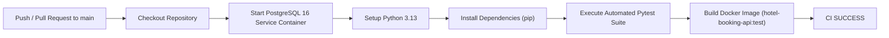
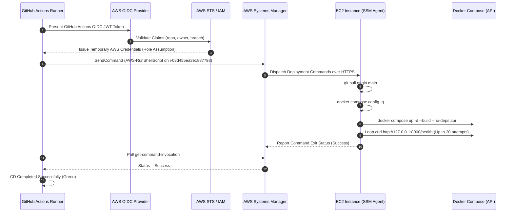

# Hotel Booking Platform — Cloud Deployment and CI/CD Automation

[](https://github.com/snehasuman019/Hotel-Booking_devops-Pr/actions/workflows/ci.yml)
[](https://github.com/snehasuman019/Hotel-Booking_devops-Pr/actions/workflows/cd.yml)

A production-grade, highly available Hotel Room Availability and Reservation Platform engineered with a resilient Python/FastAPI backend, transactional PostgreSQL database, Docker containerization, AWS Cloud infrastructure, automated GitHub Actions CI/CD with OpenID Connect (OIDC) and AWS Systems Manager (SSM) Run Command, Nginx reverse proxy with automated Let's Encrypt SSL/TLS, and automated daily Amazon S3 backups with point-in-time recovery verification.

---

## 1. Project Overview

The **Hotel Booking Platform** is an enterprise-aligned cloud project developed to demonstrate core DevOps engineering, cloud architecture, and modern backend practices. The application addresses critical business operations for the hospitality industry: real-time room discovery, rate inquiry, and automated booking creation with robust concurrency protection against double-booking.

The deployment infrastructure is hosted in AWS (**eu-north-1**) on an Amazon EC2 instance running Ubuntu Server 24.04 LTS, secured behind an Nginx reverse proxy enforcing modern HTTPS encryption. Deployments are completely automated via GitHub Actions utilizing cryptographic OpenID Connect (OIDC) authentication and AWS Systems Manager Run Command, eliminating the attack surface of persistent SSH credentials and open inbound administration ports.

---

## 2. Problem Statement

Traditional hotel booking implementations and legacy cloud deployments frequently encounter several critical engineering failures:
1. **Double Booking Under High Concurrency:** Naive reservation systems perform non-atomic read-then-write checks, allowing simultaneous customer requests to book the identical room for overlapping date ranges.
2. **Insecure Deployment Channels:** CI/CD pipelines commonly rely on long-lived SSH private keys and open inbound port 22 on production firewalls, creating severe security vulnerabilities and key management debt.
3. **Exposed Database Services:** Databases with ports bound to public interfaces (`0.0.0.0:5432`) are routinely subject to automated brute-force attacks and data compromise.
4. **Data Loss Vulnerabilities:** Systems lacking automated, encrypted, versioned off-site backups fail disaster recovery compliance and risk irreversible data loss during infrastructure outages.
5. **Downtime During Deployments:** Manual code pulling and container rebuilds risk service disruption, schema conflicts, and accidental database volume erasure.

---

## 3. Objectives

* **Zero Double-Bookings:** Enforce strict row-level transactional isolation using PostgreSQL `SELECT ... FOR UPDATE` locking to guarantee ACID compliance during concurrent booking attempts.
* **Least-Privilege, Keyless CI/CD:** Implement a secure continuous integration and continuous deployment pipeline using GitHub OIDC role assumption and AWS Systems Manager (SSM) Run Command with zero open SSH ports.
* **Defense-in-Depth Container Security:** Restrict all Docker container network bindings strictly to localhost loopback interfaces (`127.0.0.1`), terminating all public traffic through a hardened Nginx reverse proxy.
* **Enterprise SSL/TLS Termination:** Provide automated HTTPS termination via Let's Encrypt certificates with auto-renewal timers and deploy hooks.
* **Resilient Disaster Recovery:** Deploy automated cron-driven PostgreSQL dumps encrypted and versioned in an Amazon S3 bucket with automated lifecycle retention and verified restoration procedures.

---

## 4. Technology Stack

| Layer | Technology | Version | Purpose |
|---|---|---|---|
| **Backend API** | FastAPI / Python | 3.13 / 0.162+ | High-performance asynchronous REST API |
| **Data Layer** | PostgreSQL | 16-alpine | ACID relational database with row-level locking |
| **ORM & Driver** | SQLAlchemy / Psycopg | 2.0+ / 3.3+ | Object-relational mapping and connection pooling |
| **Containerization** | Docker & Docker Compose | Compose v2 | Isolated multi-container service orchestration |
| **Web Server & SSL** | Nginx & Certbot | 1.24+ | Reverse proxy, HTTPS termination, rate handling |
| **Cloud Provider** | AWS (Amazon Web Services) | Region: `eu-north-1` | Cloud compute, identity, storage, and management |
| **Compute** | Amazon EC2 | t3.small | Ubuntu Server 24.04.5 LTS host environment |
| **Networking** | Elastic IP | Static IPv4 | Reliable public ingress routing (`13.48.120.203`) |
| **Identity & Security** | AWS IAM & GitHub OIDC | v4 Actions | Keyless short-lived deployment authentication |
| **Host Management** | AWS Systems Manager (SSM) | Agent 3.3+ | Zero-SSH command execution via Run Command |
| **Storage & Backup** | Amazon S3 | Versioned/Encrypted | Off-site daily backup repository with lifecycle rules |
| **CI/CD Automation** | GitHub Actions | Workflows | Automated testing, image validation, deployment |
| **Testing** | Pytest & TestClient | 9.2+ | Unit, integration, and concurrency validation |

---

## 5. Architectural Architecture

```mermaid
flowchart TD
    subgraph Internet ["Public Internet"]
        Client["Client / Web Browser / API Consumer"]
        GH["GitHub Actions CI/CD Runner"]
    end

    subgraph AWS ["AWS Cloud (eu-north-1)"]
        subgraph IAM ["AWS IAM & Security"]
            OIDC["GitHub OIDC Identity Provider"]
            DeployRole["GitHubHotelBookingDeployRole"]
            EC2Role["EC2 Instance Profile (hotel-booking)"]
        end

        subgraph SSM ["AWS Systems Manager"]
            SSMAgent["SSM Agent (Managed Node)"]
        end

        subgraph S3 ["Amazon S3"]
            S3Bucket["hotel-booking-backup-sneha<br/>(AES-256, Versioned, Lifecycle)"]
        end

        subgraph EC2 ["Amazon EC2 (t3.small - Ubuntu 24.04)"]
            EIP["Elastic IP: 13.48.120.203"]
            Nginx["Nginx Reverse Proxy (Port 80/443)<br/>Let's Encrypt SSL/TLS"]
            Cron["Cron Daemon (0 2 * * *)<br/>backup-hotel-db.sh"]

            subgraph DockerEnv ["Docker Compose Runtime"]
                API["hotel-booking-api<br/>FastAPI / Python 3.13<br/>127.0.0.1:8000"]
                DB["hotel-booking-db<br/>PostgreSQL 16-alpine<br/>127.0.0.1:5432"]
                Vol[("Persistent Volume:<br/>postgres_data")]
            end
        end
    end

    Client -->|HTTPS / Port 443| Nginx
    Nginx -->|Reverse Proxy / HTTP| API
    API -->|SQLAlchemy / Psycopg 3| DB
    DB -->|Read / Write| Vol

    GH -->|1. Request Token| OIDC
    OIDC -->|2. Issue Short-Lived STS Credentials| GH
    GH -->|3. ssm:SendCommand (AWS-RunShellScript)| SSMAgent
    SSMAgent -->|4. Pull & Rebuild API Container| API

    Cron -->|Daily pg_dump| DB
    Cron -->|Encrypted Upload via EC2 Role| S3Bucket
```

---

## 6. Backend API Structure

The API is structured around transactional hospitality business workflows:

```
app/
├── database.py       # Engine creation, connection pool with pool_pre_ping, SessionLocal
├── main.py           # FastAPI application definition, routing, and transactional logic
├── models.py         # SQLAlchemy ORM declarations (Room, Reservation)
└── schemas.py        # Pydantic validation schemas with ConfigDict
```

### Endpoints Reference

| Method | Endpoint | Description | Status Codes |
|---|---|---|---|
| `GET` | `/` | Application welcome & health status message | `200` |
| `GET` | `/health` | Liveness health check endpoint | `200` |
| `GET` | `/db-test` | Active database connection confirmation | `200`, `503` |
| `GET` | `/rooms` | List all active hotel rooms | `200` |
| `GET` | `/rooms/{room_id}` | Retrieve specific room details | `200`, `404` |
| `GET` | `/availability` | Check room availability for date range (`check_in`, `check_out`) | `200`, `400` |
| `POST` | `/reservations` | Reserve a room with transactional row-locking protection | `201`, `400`, `404`, `409` |
| `GET` | `/docs` | Interactive Swagger UI API documentation | `200` |

### Concurrency Protection & Overlap Detection
Overlapping reservations are prevented using a database transaction with PostgreSQL row locking:
```python
# Lock the target room record until the transaction concludes
room = (
    db.query(Room)
    .filter(Room.id == reservation.room_id, Room.is_active.is_(True))
    .with_for_update()
    .first()
)

# Overlap formula: (existing.check_in < requested.check_out) AND (existing.check_out > requested.check_in)
existing_booking = (
    db.query(Reservation)
    .filter(
        Reservation.room_id == reservation.room_id,
        Reservation.status == "CONFIRMED",
        Reservation.check_in < reservation.check_out,
        Reservation.check_out > reservation.check_in
    )
    .first()
)

if existing_booking:
    raise HTTPException(status_code=409, detail="Room is already booked for these dates")
```
When two identical requests arrive simultaneously, the first transaction acquires the lock and creates the reservation (`HTTP 201`). The second waits, detects the confirmed overlapping dates, rolls back, and returns `HTTP 409 Conflict`.

---

## 7. Database Schema

### `rooms` Table
```sql
CREATE TABLE rooms (
    id SERIAL PRIMARY KEY,
    room_number VARCHAR(10) UNIQUE NOT NULL,
    room_type VARCHAR(50) NOT NULL,
    price_per_night NUMERIC(10, 2) NOT NULL,
    is_active BOOLEAN DEFAULT TRUE NOT NULL
);
```

### `reservations` Table
```sql
CREATE TABLE reservations (
    id SERIAL PRIMARY KEY,
    reference VARCHAR(20) UNIQUE NOT NULL,
    room_id INTEGER NOT NULL REFERENCES rooms(id),
    guest_name VARCHAR(100) NOT NULL,
    check_in DATE NOT NULL,
    check_out DATE NOT NULL,
    status VARCHAR(20) DEFAULT 'CONFIRMED' NOT NULL,
    created_at TIMESTAMP WITH TIME ZONE DEFAULT NOW()
);
```

---

## 8. Docker and Security Isolation

The platform uses Docker Compose to orchestrate application and database services while strictly enforcing network isolation.

```yaml
services:
  db:
    image: postgres:16-alpine
    container_name: hotel-booking-db
    restart: unless-stopped
    environment:
      POSTGRES_USER: ${POSTGRES_USER}
      POSTGRES_PASSWORD: ${POSTGRES_PASSWORD}
      POSTGRES_DB: ${POSTGRES_DB}
    ports:
      - "127.0.0.1:5432:5432"
    volumes:
      - postgres_data:/var/lib/postgresql/data
    healthcheck:
      test: ["CMD-SHELL", "pg_isready -U ${POSTGRES_USER} -d ${POSTGRES_DB}"]
      interval: 10s
      timeout: 5s
      retries: 5

  api:
    build: .
    container_name: hotel-booking-api
    restart: unless-stopped
    environment:
      DATABASE_URL: postgresql+psycopg://${POSTGRES_USER}:${POSTGRES_PASSWORD}@db:5432/${POSTGRES_DB}
    ports:
      - "127.0.0.1:8000:8000"
    depends_on:
      db:
        condition: service_healthy

volumes:
  postgres_data:
```

### Security Highlights:
* **Loopback Binding Only:** Both PostgreSQL (`127.0.0.1:5432`) and FastAPI (`127.0.0.1:8000`) bind strictly to localhost. They are completely inaccessible from the public internet.
* **Data Volume Persistence:** Database data is mounted on named volume `postgres_data`. Automated deployments rebuild only the `api` container, ensuring the volume and database states remain undisturbed.

---

## 9. CI Pipeline (Continuous Integration)

Workflow file: `.github/workflows/ci.yml`



The CI workflow validates every commit by spinning up an ephemeral PostgreSQL 16 service, installing dependencies, executing test suites for endpoints and concurrency, and building the production Docker container.

---

## 10. CD Pipeline (Continuous Deployment via OIDC & SSM)

Workflow file: `.github/workflows/cd.yml`



### Key Advantages of OIDC + SSM vs SSH:
1. **Zero Long-Lived Secrets:** No SSH private keys stored in GitHub Secrets.
2. **Zero Inbound Attack Surface:** EC2 Security Group requires NO inbound port 22 access. The SSM Agent maintains an outbound TLS tunnel to AWS Systems Manager.
3. **Audited Identity:** IAM enforces repository-level and branch-level claims cryptographically.
4. **Autonomous Health Check:** Deployment verifies local API liveness before declaring success.

---

## 11. AWS Infrastructure

* **Region:** `eu-north-1` (Stockholm)
* **Instance ID:** `i-03d455ea3e1887798`
* **Instance Type:** `t3.small` (2 vCPU, 2 GB RAM)
* **Operating System:** Ubuntu Server 24.04.5 LTS
* **Static Elastic IP:** `13.48.120.203`
* **Private IP:** `172.31.14.163`
* **EC2 IAM Role:** `hotel-booking` (Permissions: `AmazonSSMManagedInstanceCore`, S3 Backup Policy)

---

## 12. Nginx Reverse Proxy and HTTPS Setup

Nginx handles incoming public requests, terminates TLS, and proxies traffic to the internal FastAPI service on `127.0.0.1:8000`.

### Nginx Configuration (`/etc/nginx/sites-available/default`)
```nginx
server {
    listen 80;
    server_name 13.48.120.203;
    return 301 https://$host$request_uri;
}

server {
    listen 443 ssl http2;
    server_name 13.48.120.203;

    ssl_certificate /etc/letsencrypt/live/13.48.120.203/fullchain.pem;
    ssl_certificate_key /etc/letsencrypt/live/13.48.120.203/privkey.pem;

    ssl_protocols TLSv1.2 TLSv1.3;
    ssl_ciphers HIGH:!aNULL:!MD5;

    location / {
        proxy_pass http://127.0.0.1:8000;
        proxy_set_header Host $host;
        proxy_set_header X-Real-IP $remote_addr;
        proxy_set_header X-Forwarded-For $proxy_add_x_forwarded_for;
        proxy_set_header X-Forwarded-Proto $scheme;
    }
}
```

* **Automated SSL Certificate:** Issued by Let's Encrypt for IP `13.48.120.203`.
* **Auto-Renewal:** Managed by systemd timer `certbot.timer` with automated Nginx reload deploy hook (`systemctl reload nginx`).

---

## 13. Amazon S3 Automated Backups & Disaster Recovery

* **S3 Bucket:** `hotel-booking-backup-sneha`
* **Configuration:** Private, Block Public Access enabled, Default AES-256 Server-Side Encryption, Versioning enabled, Lifecycle expiration rule.
* **Backup Script:** `/home/ubuntu/backup-hotel-db.sh`
* **Cron Schedule:** `0 2 * * *` (Daily at 02:00 UTC / 07:30 IST)

### Backup Script Operation
1. Dumps PostgreSQL using `docker exec hotel-booking-db pg_dump -U hotel_user hotel_booking`.
2. Compresses the dump with `gzip`.
3. Streams the compressed archive to `s3://hotel-booking-backup-sneha/backups/`.
4. Enforces a 7-day retention policy for local backup archives.

### Tested Restoration Procedure
Restoration was independently validated using a temporary restoration database (`hotel_booking_restore_test`):
```bash
# 1. Download latest archive from S3
aws s3 cp s3://hotel-booking-backup-sneha/backups/hotel_booking_backup_latest.sql.gz /tmp/restore.sql.gz

# 2. Decompress archive
gunzip /tmp/restore.sql.gz

# 3. Restore to test database
docker exec -i hotel-booking-db psql -U hotel_user -d hotel_booking_restore_test < /tmp/restore.sql

# 4. Verify data integrity
docker exec -i hotel-booking-db psql -U hotel_user -d hotel_booking_restore_test -c "SELECT count(*) FROM rooms;"
# Output: 3 rooms verified
```

---

## 14. Security Measures & Defense-in-Depth

1. **Least-Privilege IAM Policies:** Distinct IAM roles for EC2 instance operations and GitHub deployment.
2. **Zero Inbound Admin Ports:** No open SSH port (22) in EC2 security groups. Remote management executed exclusively via AWS Systems Manager.
3. **Loopback Service Isolation:** FastAPI and PostgreSQL are bound exclusively to `127.0.0.1`.
4. **Short-Lived Cryptographic Credentials:** GitHub Actions authenticates through OIDC with temporary STS session tokens valid for maximum 1 hour.
5. **Database Transaction Locks:** Concurrency collisions resolved with `SELECT FOR UPDATE` row locks, preventing race conditions.
6. **Encrypted Backups:** S3 bucket blocks all public access and enforces SSE-S3 encryption at rest.

---

## 15. Local Installation and Testing Instructions

### Prerequisites
* Python 3.13+
* Docker & Docker Compose
* Git

### Step-by-Step Setup
```bash
# 1. Clone repository
git clone https://github.com/snehasuman019/Hotel-Booking_devops-Pr.git
cd Hotel-Booking_devops-Pr

# 2. Configure environment
cp .env.example .env
# Edit .env with secure credentials

# 3. Create and activate virtual environment
python -m venv venv
# Windows:
.\venv\Scripts\activate
# Linux/macOS:
source venv/bin/activate

# 4. Install dependencies
pip install -r requirements.txt

# 5. Launch containers locally
docker compose up -d --build

# 6. Execute test suite
python -m pytest -v
```

---

## 16. Comprehensive Documentation Suite

Detailed operational, architectural, security, and recovery documentation is organized in dedicated guides:
* 🏛️ [System Architecture & Data Flow](docs/architecture.md): High-level system design, multi-container interactions, and AWS cloud topology.
* 📊 [Architecture Diagrams](docs/architecture-diagram.md): Complete Mermaid diagrams (Cloud VPC topology, Database ER model, Concurrency row-locking sequence).
* 🛠️ [Operations & Troubleshooting Runbook](docs/runbook.md): Service lifecycle management, health probes, log inspection, and troubleshooting guides for 5+ failure scenarios.
* 💾 [Database Backup & Restoration Runbook](docs/backup-restore.md): Automated S3 backup lifecycle, retention policies, and non-destructive disaster recovery procedures.
* 🔒 [Security & Compliance Architecture](docs/security.md): Network isolation, TLS encryption, keyless GitHub OIDC, container hardening, and PII protection.
* 🧪 [Testing & Quality Assurance Guide](docs/testing.md): Automated Pytest suite (16 tests), concurrency test harness, and CI/CD validation.
* 📘 [Monitoring, Logging & Rollback Runbook](docs/MONITORING_AND_ROLLBACK_GUIDE.md): Host resource checks, Docker logging limits, live query troubleshooting, and automated rollback scripts.
* 🎓 [Assessment Defense & Technical Interview Guide](docs/ASSESSMENT_DEFENSE_AND_INTERVIEW_PREP.md): Architectural decisions explained (FastAPI vs. Django, row locking, zero-SSH deployment, disaster recovery) with 8 comprehensive interview questions and model answers.

---

## 17. Final Demonstration & Verification Checklist

- [x] Application health endpoint returns `{"status":"healthy"}` over HTTPS (`https://13.48.120.203/health`).
- [x] Active hotel rooms list successfully loaded (`https://13.48.120.203/rooms`).
- [x] Room detail endpoint verified (`/rooms/1` returns Room 101, `/rooms/999` returns `404 Not Found`).
- [x] Date availability check returns active inventory (`/availability?check_in=...&check_out=...`).
- [x] Invalid date ordering returns `400 Bad Request` validation error.
- [x] Concurrency test demonstrates one booking confirmed (`201`) and one rejected with conflict (`409`).
- [x] Nginx terminates TLS with valid Let's Encrypt certificates.
- [x] PostgreSQL database runs in Docker with persistent volume `postgres_data`.
- [x] Automated S3 backups running via cron with verified restoration procedure.
- [x] GitHub Actions CI pipeline builds and tests code on every push.
- [x] GitHub Actions CD pipeline configured with keyless OIDC and AWS Systems Manager.

---

## 18. Resume-Ready Project Summary

**Cloud DevOps & Platform Engineer — Hotel Booking Platform**
* Architected and deployed an automated, containerized hotel reservation platform on AWS (EC2, S3, IAM, SSM) serving asynchronous REST APIs via FastAPI and PostgreSQL 16.
* Eliminated double-booking race conditions by implementing PostgreSQL transactional row locking (`SELECT FOR UPDATE`), achieving strict ACID concurrency control under simultaneous load.
* Engineered a secure, keyless CI/CD pipeline using GitHub Actions, OpenID Connect (OIDC), and AWS Systems Manager Run Command, eliminating persistent SSH keys and closing inbound management ports.
* Hardened production host security by binding container ports strictly to localhost loopback interfaces and configuring an Nginx reverse proxy with automated Let's Encrypt SSL/TLS certificate renewals.
* Formulated an automated disaster recovery strategy featuring daily encrypted PostgreSQL dumps streamed to Amazon S3 with lifecycle management and verified restoration testing.
