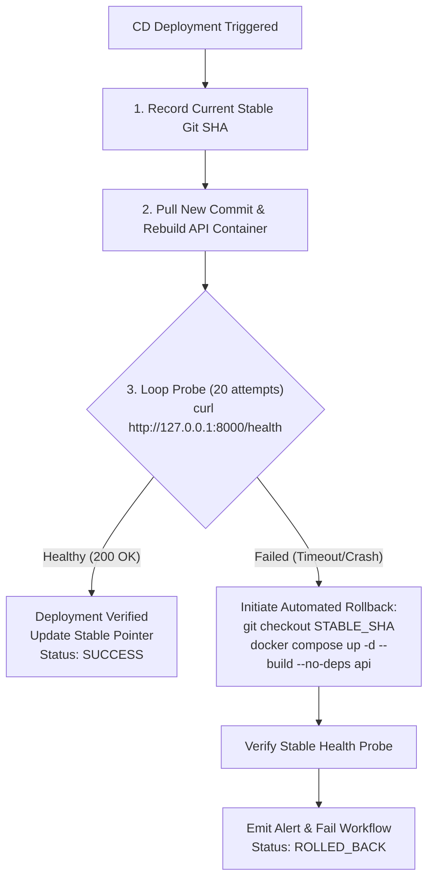

# Hotel Booking Platform — Monitoring, Logging, and Rollback Runbook

This guide covers operational monitoring, log inspection, host health metrics, and safe rollback procedures for the Hotel Booking Platform running on AWS EC2.

---

## 1. Application and Container Health Monitoring

### A. Checking Container Health and Status
Execute the following on the **EC2 Ubuntu terminal**:

```bash
cd /home/ubuntu/Hotel-Booking_devops-Pr
docker compose ps
```

**Expected Output:**
```
NAME                IMAGE                COMMAND                  SERVICE   CREATED         STATUS                    PORTS
hotel-booking-api   hotel-booking-api    "uvicorn app.main:ap…"   api       2 hours ago     Up 2 hours (healthy)      127.0.0.1:8000->8000/tcp
hotel-booking-db    postgres:16-alpine   "docker-entrypoint.s…"   db        4 days ago      Up 4 days (healthy)       127.0.0.1:5432->5432/tcp
```
*Notice both containers indicate `(healthy)`.*

### B. Inspecting Live Health Endpoints
From your **local Windows PowerShell** or directly on **EC2**:

```bash
# Public HTTPS Health Check
curl -i https://13.48.120.203/health

# Local API Probe (Loopback)
curl -i http://127.0.0.1:8000/health
```

**Expected Output:**
```http
HTTP/1.1 200 OK
Content-Type: application/json

{"status":"healthy"}
```

---

## 2. Centralized Logging & Troubleshooting

### A. FastAPI Application Logs
Stream live backend logs or view the last 100 entries:

```bash
# Follow live logs
docker compose logs -f api

# View the last 100 lines with timestamps
docker compose logs --tail=100 -t api
```

### B. PostgreSQL Database Logs
Inspect database queries, connection pools, and lock acquisition:

```bash
docker compose logs --tail=100 -t db
```

### C. Nginx Reverse Proxy Logs
Inspect public web requests and SSL/TLS handshakes:

```bash
# Ingress access logs (HTTP response codes, client IPs, user agents)
sudo tail -n 100 /var/log/nginx/access.log

# Ingress error logs (upstream timeouts, reverse proxy failures)
sudo tail -n 100 /var/log/nginx/error.log
```

### D. Enforced Log Rotation
To protect the EC2 host from running out of disk space, logging limits are enforced in `docker-compose.yml`:
* `max-size: "10m"`
* `max-file: "3"`
* *Maximum log disk consumption per service is capped at 30 MB.*

---

## 3. Server & Host Resource Monitoring

### A. Host Resource Consumption Commands (Run on EC2)

```bash
# 1. Memory Usage (RAM and Swap)
free -h

# 2. Disk Space Utilization
df -h /

# 3. CPU and Load Averages
uptime
top -b -n 1 | head -n 20

# 4. Per-Container Resource Stats (Real-time CPU%, Mem%, Net I/O)
docker stats --no-stream
```

### B. CloudWatch Monitoring Strategy for Small Instances (`t3.small`)

For cost-effectiveness and performance on a `t3.small` instance (2 GB RAM):
* **Default Free Metrics (5-minute frequency)**:
  - `CPUUtilization`: Measures instance compute load.
  - `StatusCheckFailed_System` / `StatusCheckFailed_Instance`: Tracks hardware and OS responsiveness.
  - `NetworkIn` / `NetworkOut`: Monitors traffic spikes.

### C. Recommended CloudWatch Alarms

1. **High CPU Utilization Alarm**:
   - **Metric**: `AWS/EC2 -> CPUUtilization`
   - **Threshold**: $\ge 80\%$ for 2 consecutive periods of 5 minutes.
   - **Action**: Send SNS notification to administrator email.
2. **Instance Health Check Failure Alarm**:
   - **Metric**: `AWS/EC2 -> StatusCheckFailed`
   - **Threshold**: $\ge 1$ for 1 minute.
   - **Action**: Send critical alert and trigger EC2 auto-recovery.

---

## 4. Deployment Rollback Strategy

A safe rollback mechanism guarantees that if a newly deployed code version fails health checks or introduces bugs, the system can instantly revert to the last known good state without causing data loss.

### Safety Guarantee: Database Preservation
> [!IMPORTANT]
> **NEVER execute `docker compose down -v` during a rollback.**
> Named Docker volume `postgres_data` contains all active reservations and room data. Recreating the `api` container preserves all database rows.

---

### A. Manual Rollback Procedure (Run on EC2)

If a deployment introduces issues, execute these exact steps on the EC2 Ubuntu host:

```bash
cd /home/ubuntu/Hotel-Booking_devops-Pr

# 1. Identify the last working commit hash
git log --oneline -n 5

# 2. Revert to the previous stable commit (e.g., HEAD~1 or specific commit SHA)
git checkout HEAD~1

# 3. Validate docker compose syntax
docker compose config -q

# 4. Rebuild and restart only the API service
docker compose up -d --build --no-deps api

# 5. Verify application health probe
curl --fail http://127.0.0.1:8000/health

# 6. Verify container status
docker compose ps
```

---

### B. Automated Deployment Rollback Architecture

For continuous delivery pipelines, automated rollback operates via a transactional health probe loop:



### Self-Healing Rollback Script Implementation
Save as `/home/ubuntu/deploy-with-rollback.sh`:

```bash
#!/bin/bash
set -euo pipefail

APP_DIR="/home/ubuntu/Hotel-Booking_devops-Pr"
cd "$APP_DIR"

# Capture current stable commit SHA
PREV_STABLE_COMMIT=$(git rev-parse HEAD)
echo "Current stable commit: $PREV_STABLE_COMMIT"

# Pull latest code
git pull origin main
NEW_COMMIT=$(git rev-parse HEAD)
echo "Deploying new commit: $NEW_COMMIT"

# Rebuild and restart API container
docker compose up -d --build --no-deps api

# Health check loop (60 seconds max)
echo "Validating health endpoint..."
SUCCESS=0
for i in $(seq 1 20); do
  if curl --silent --fail http://127.0.0.1:8000/health > /dev/null; then
    echo "Health check passed on attempt $i."
    SUCCESS=1
    break
  fi
  sleep 3
done

if [ "$SUCCESS" -eq 1 ]; then
  echo "Deployment successful: $NEW_COMMIT is live."
  docker compose ps
  exit 0
else
  echo "ERROR: Health check failed! Initiating rollback to $PREV_STABLE_COMMIT..."
  git checkout "$PREV_STABLE_COMMIT"
  docker compose up -d --build --no-deps api
  
  if curl --silent --fail http://127.0.0.1:8000/health > /dev/null; then
    echo "Rollback successful: System restored to $PREV_STABLE_COMMIT."
  else
    echo "CRITICAL: System unstable after rollback! Manual intervention required."
  fi
  exit 1
fi
```
