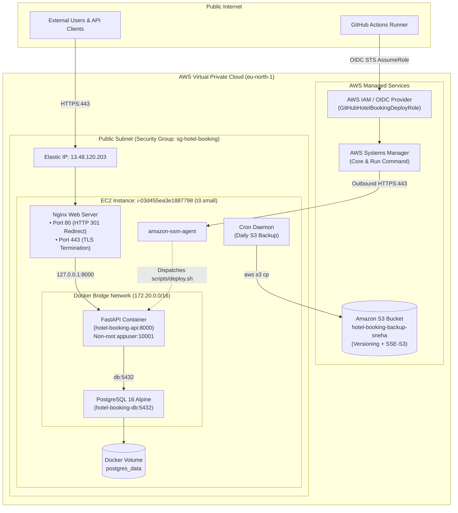
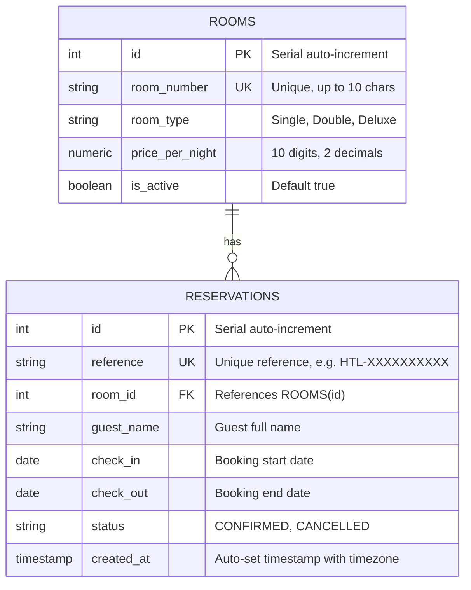
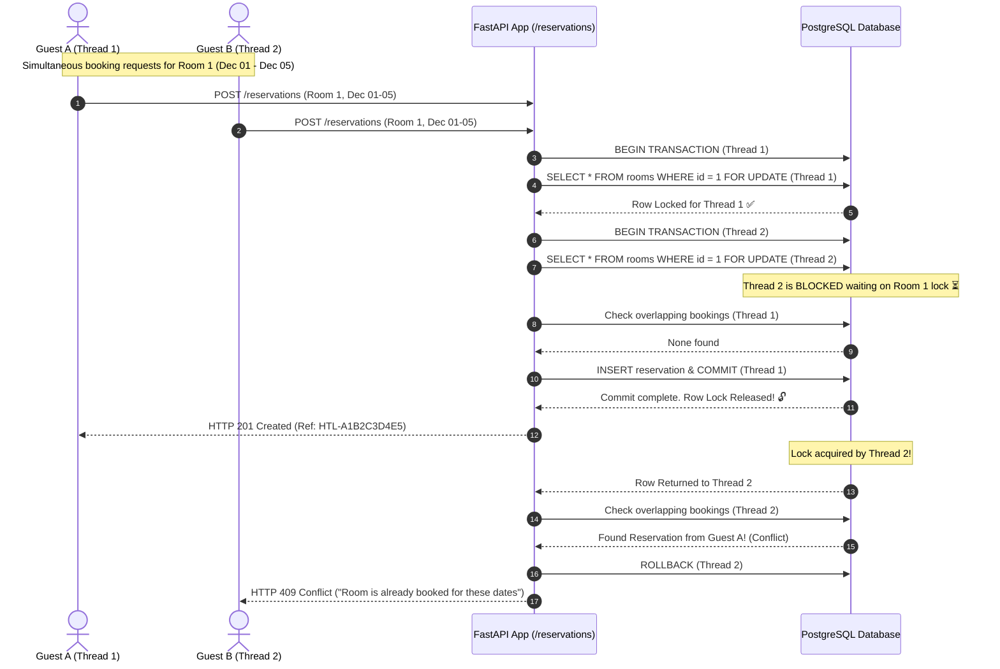

# Architecture Diagrams

This document contains dedicated visual diagrams representing the Hotel Booking Platform's infrastructure, network security topology, database schema, and deployment workflows.

---

## 1. Cloud Infrastructure & Network Topology

---

## 2. Database Entity-Relationship (ER) Diagram

---

## 3. Concurrency Protection & Row-Level Locking Sequence

