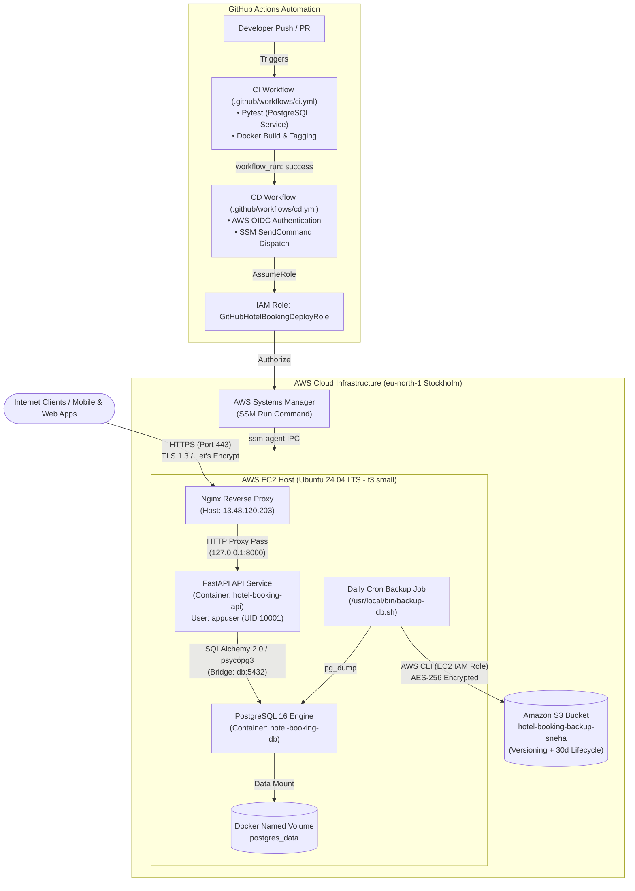
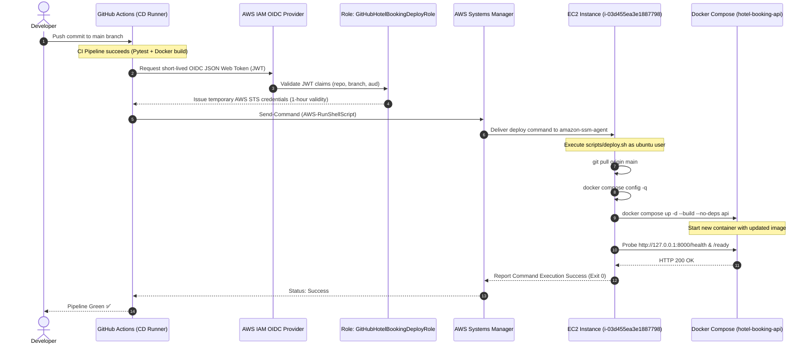

# System & Cloud Architecture

## 1. High-Level System Architecture

The **Hotel Booking Platform** is engineered as a cloud-native, multi-container microservice deployed on an **AWS EC2 Ubuntu 24.04** host. It incorporates automated Continuous Integration and Continuous Deployment (CI/CD) with zero static credentials using **GitHub Actions OIDC** and **AWS Systems Manager (SSM)**.

---

## 2. Component Breakdown

### 2.1 Backend Application Layer (`api`)
* **Framework:** FastAPI (Python 3.13-slim) running via `uvicorn` ASGI server.
* **Security Context:** Hardened container running as unprivileged system user `appuser` (UID 10001).
* **Data Access:** SQLAlchemy 2.0 ORM with asynchronous-ready `psycopg` binary driver.
* **Concurrency Engine:** Implements row-level pessimistic locking (`SELECT ... FOR UPDATE`) on the `rooms` table to guarantee zero double-bookings under concurrent load.
* **Endpoints:**
  - `GET /` — Service status check.
  - `GET /health` — Application liveness probe.
  - `GET /ready` — Deep readiness probe validating database connectivity.
  - `GET /db-test` — Database connectivity and dialect test.
  - `GET /rooms` & `GET /rooms/{id}` — Room catalog.
  - `POST /reservations` — Atomic booking creation with overlap conflict detection.
  - `GET /availability` — Dynamic vacancy search excluding confirmed overlapping bookings.
  - `GET /docs` — OpenAPI / Swagger interactive documentation.

### 2.2 Database & Persistence Layer (`db`)
* **Database Engine:** PostgreSQL 16 Alpine.
* **Network Binding:** Strictly bound to `127.0.0.1:5432` on the EC2 host. Only reachable from the Docker bridge network by the `api` container.
* **Storage Engine:** Persistent Docker named volume `postgres_data` mapped to `/var/lib/postgresql/data`. Survives container lifecycles, upgrades, and rollbacks.
* **Healthcheck:** Monitored continuously using `pg_isready -U ${POSTGRES_USER} -d ${POSTGRES_DB}`.

### 2.3 Edge Ingress & Networking (`nginx`)
* **Reverse Proxy:** Nginx 1.24 terminates TLS/SSL and proxies requests locally to `http://127.0.0.1:8000`.
* **TLS Security:** Let's Encrypt TLS certificate with automatic renewal via Certbot.
* **HTTP Redirection:** Port 80 unconditionally issues HTTP 301 Permanent Redirect to HTTPS on port 443.
* **Header Forwarding:** Propagates `Host`, `X-Real-IP`, `X-Forwarded-For`, and `X-Forwarded-Proto` for accurate client telemetry.

---

## 3. CI/CD Architecture & Zero-Secret Deployment

The deployment pipeline uses modern **OpenID Connect (OIDC)** authentication, eliminating the need to store long-lived AWS Access Keys or SSH private keys in GitHub repository secrets:

---

## 4. Disaster Recovery & Backup Architecture

* **Automated Daily Dumps:** Linux `cron` triggers `/usr/local/bin/backup-db.sh` daily at 02:00 UTC.
* **Atomic Backup:** Executes `pg_dump` inside the `hotel-booking-db` container, compressing output to `.sql.gz`.
* **Encrypted Object Storage:** Streams compressed backups to private Amazon S3 bucket `hotel-booking-backup-sneha` in `eu-north-1`.
* **Retention Policy:** Versioning protects against accidental overwrites; S3 Lifecycle rules automatically transition older dumps and purge after 30 days.
